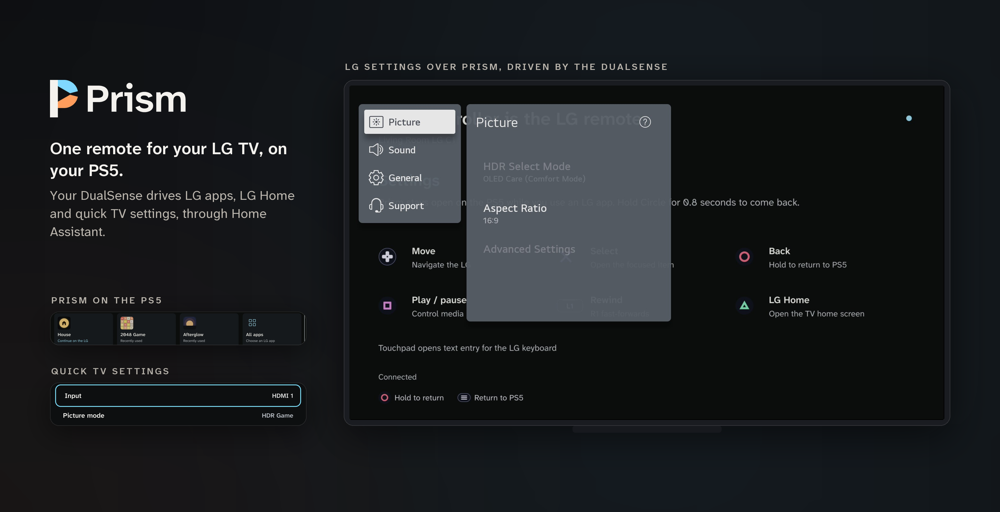
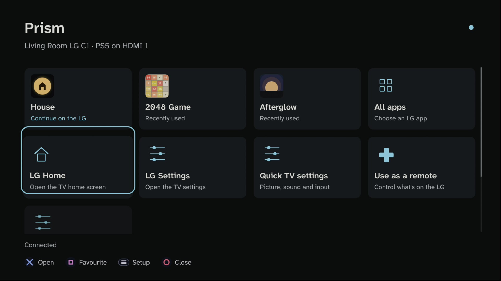
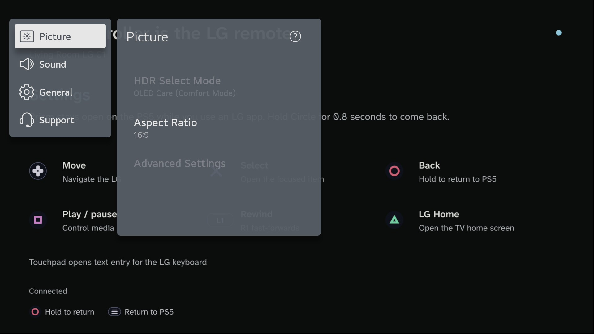
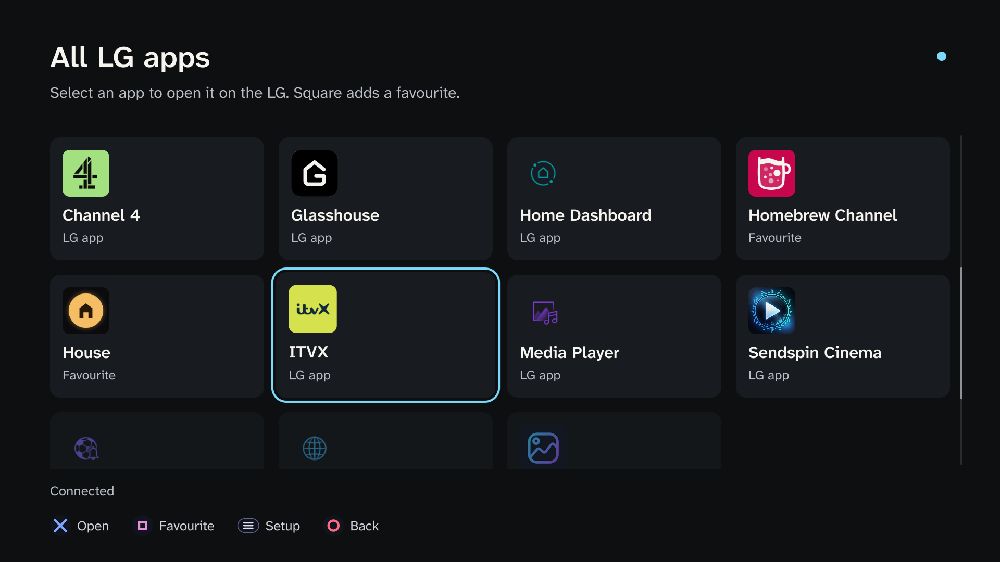
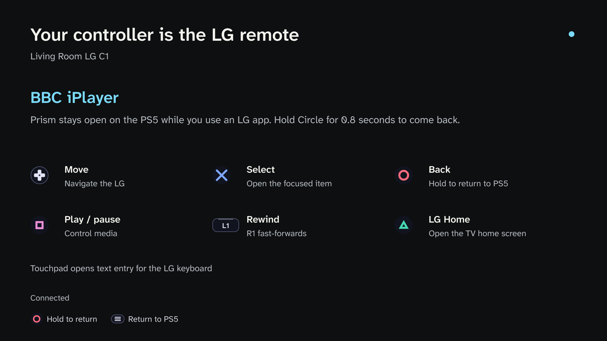
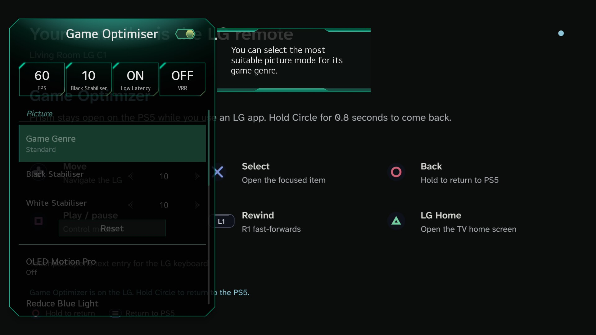
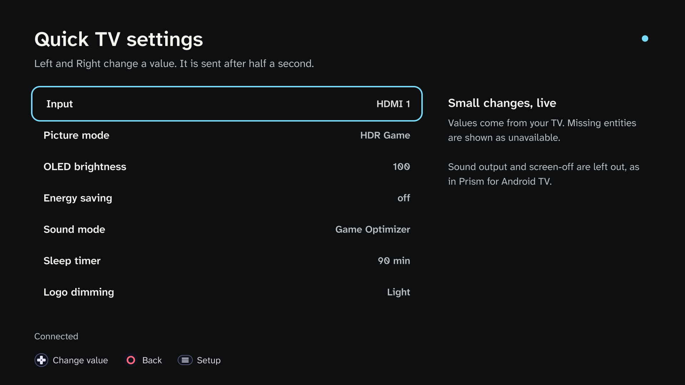

<p align="center">
  
</p>

# Prism for PS5

One remote for your LG TV, on your PS5. Open an LG app from Prism, leave Prism running on the PS5, and the
DualSense drives the LG: the D-pad, Cross, Circle, play/pause, rewind and fast-forward go to the TV through Home
Assistant. Hold Circle to switch the TV back to the PS5.

Prism is also a launcher for the LG, so you can open LG apps, LG Home, LG Settings and a few common TV settings
without picking up the LG remote. It is the PS5 edition of [Prism for Android TV](https://github.com/HaydenGriffin/prism),
which does the same from an Android TV box's remote.

> **Status:** Prism has run on one PS5 (system software 7.20, ShadowMount Plus 1.7-beta5fix1, ftpsrv
> 0.21.1) with a rooted 2021 LG C1 and a Home Assistant of about 3,100 entities. Connecting, the launcher, opening
> LG apps, LG Home and LG Settings, the D-pad, Cross and Back, and the screens LG Settings opens (Game Optimizer)
> were checked there. Holding Circle to return, touchpad text entry, long idle sessions and rest mode have not been
> confirmed yet. See [console validation](docs/console-validation.md). Reports either way are very welcome.

## What it does

- **Drives the LG from the DualSense.** While an LG app or menu is on the TV, Prism forwards the controller to it.
  When LG Settings hands over to another LG screen (such as Game Optimizer), the controller follows it.
- **Hold Circle to come back.** Tap Circle for Back; hold it for 0.8 s to switch the TV to the PS5's input without a
  stray Back first. If an LG menu covers the PS5's input, Prism dismisses it on the way.
- **A launcher for the LG.** Your favourite LG apps as big tiles with their own LG icons, recently used apps, all
  apps, LG Home, LG Settings, and a "Continue on the LG" tile for the last LG app you used.
- **Quick TV settings.** Input, picture mode, OLED brightness, energy saving, sound mode, sleep timer and logo
  dimming, changed with Left and Right. A change is sent half a second after the last step.
- **The LG keyboard.** While the LG's on-screen keyboard is up, the touchpad opens the PS5 keyboard and sends what
  you type; L2 and R2 are Backspace and Enter. This needs Glasshouse's keyboard entities.
- **Follows Home Assistant.** Prism finds the TV from Home Assistant's registries and matches entities by their
  role, so renaming them is fine. It reconnects on its own and never replays a press from before a dropped
  connection.

Prism cannot read another PS5 title's controller input: keep Prism open while you use the LG. The PS button belongs
to the system; Prism pauses while the system menu is up and waits for you to let go of every button before it
forwards again.

## Screenshots

The ones marked "on the TV" were taken by the TV itself (a 2021 LG C1) while the PS5 showed Prism. The rest are
rendered by Prism's own UI code and shaders from a live Home Assistant; see [Promotional pictures](#promotional-pictures).

| The launcher, on the TV | LG Settings opened from Prism, on the TV |
|---|---|
|  |  |

| All LG apps | Controlling an LG app |
|---|---|
|  |  |

| Game Optimizer from LG Settings, on the TV | Quick TV settings |
|---|---|
|  |  |

## Requirements

- **A jailbroken PS5 that runs folder homebrew** from `/data/homebrew/<TITLE_ID>`, with an enabler such as
  [ShadowMount Plus](https://github.com/drakmor/ShadowMountPlus) and an FTP server (port 2121 is the usual one).
  This guide does not explain jailbreaking.
- **An LG TV running webOS, rooted, with [Glasshouse](https://github.com/rorygallagher2024/glasshouse) and its Home
  Assistant MQTT bridge**, as for [Prism for Android TV](https://github.com/HaydenGriffin/prism#requirements).
  Glasshouse's Launch App, Active App, Input Source and navigation button entities must be enabled; the settings,
  media and keyboard entities are used when they exist.
- **Home Assistant on your local network, at a numeric IPv4 address over plain HTTP** (for example
  `192.168.1.10:8123`). The PS5 does not resolve names such as `homeassistant.local`, and HTTPS, IPv6 and
  reverse-proxy paths are not supported.

## Install

Download `PPSA99483.zip` from [Releases](https://github.com/HaydenGriffin/prism-ps5/releases) and check it against
`SHA256SUMS`. Extract it and copy the `PPSA99483` folder to `/data/homebrew/` on the console over FTP, so that you
end up with `/data/homebrew/PPSA99483/eboot.bin` and `/data/homebrew/PPSA99483/sce_sys/param.json`. Don't upload the
ZIP itself.

Wait about ten seconds for the enabler to register the title, then start **Prism** from the home screen; it sits
with the media apps. Its title ID and storage are its own (Afterglow is `PPSA99481`), but check that no other
homebrew on your console uses `PPSA99483`.

From a checkout, `make deploy PS5_HOST=<console address>` uploads the built folder instead, publishing `eboot.bin`
and `param.json` last. Close Prism first.

## Set up

Open Prism and choose **Setup** (Options). Work down the list:

1. **Home Assistant address and port**, typed with the PS5 keyboard (normally port `8123`).
2. **Access token.** Make a long-lived access token on your Home Assistant profile page; a local non-admin user
   is enough. The keyboard hides it, and Prism never shows it.
3. **Connect / retry.** A rejected token is not retried on its own: replace it and connect again.
4. **TV.** Choose your Glasshouse TV.
5. **Use this input for the PS5.** While the PS5 is on screen, select this row. Prism notes the input and its
   HDMI app; nothing switches. Do it again if you move the cable.
6. **Favourites**, then back to the launcher and open an LG app.

**Controller vibration** is off by default; turn it on in Setup for a short rumble on each move.

**Setting up from a computer.** Copy `prism.conf.example` to `prism.conf`, fill it in, and put it beside
`eboot.bin`. Besides `host`, `port` and `token`, it can hold `device`, `input` and `input_app` (the TV's Home
Assistant device ID, the PS5's input option and its HDMI app, such as `HDMI 1` and `com.webos.app.hdmi1`). Prism
reads it only while it has no saved settings. Change any setting once so Prism saves its own copy (Setup shows
**Saved on this PS5**), then delete `prism.conf`: anyone on your network can read the install folder over FTP.

**Where the token lives.** Prism keeps its settings, token included, in plain text in its own storage
(`/download0/prism/settings.json`, mode `0600`), and Home Assistant's local HTTP sends it unencrypted. Use a trusted
network. **Disconnect and forget token** in Setup removes the saved copy; revoke the token in Home Assistant to
cancel it.

## Controls

On Prism's own screens, the D-pad or left stick moves, Cross opens, Square adds or removes a favourite, Options
opens Setup, and Circle goes back (on the launcher, it asks to close Prism). L1 and R1 reorder favourites.

While the DualSense drives the LG:

| Control | Action |
| --- | --- |
| D-pad / left stick | Move |
| Cross | OK |
| Circle, tapped | Back |
| Circle, held for 0.8 s | Switch the TV to the PS5 |
| Options | Switch the TV to the PS5 |
| Square | Play / pause |
| L1 / R1 | Rewind / fast-forward |
| Triangle | LG Home |
| Touchpad | Type into the LG keyboard, while it is up |
| L2 / R2 | LG keyboard Backspace / Enter |
| PS | The PS5's system menu; Prism pauses |

Prism only sends presses while the TV shows an LG app, an LG menu or the LG keyboard, never to another HDMI
device. Switching the TV back with the LG's own remote also returns Prism to its launcher. If Home Assistant
drops, use the LG remote until Prism reconnects.

Recent apps are the LG apps Prism has seen on the TV, kept on the PS5. Icons come from Glasshouse's icon server at
its numeric address; no Home Assistant token is sent there.

## Build and test

With Docker on Linux or a Mac:

```sh
docker build -t prism-ps5-builder .
docker run --rm -v "$PWD:/work" prism-ps5-builder make lint test
docker run --rm -v "$PWD:/work" prism-ps5-builder make preview
docker run --rm -v "$PWD:/work" prism-ps5-builder make app
```

- `make app` builds `dist/PPSA99483/` (the installable folder) and `dist/PPSA99483.zip`. Credentials are never
  included.
- `make test` runs the host checks under AddressSanitizer and UndefinedBehaviorSanitizer, and the native client
  against a fake Home Assistant: authentication, fragmented and 3 MB messages, acknowledgements and refusals,
  registry changes, reconnecting without replay, controller timing, and saving settings.
- `make preview` renders every screen offscreen with **the same UI code and shaders** as the console, using
  made-up data, into `build/preview/`.
- `make lint` checks formatting, source notices, the package identity, the presentation assets and the shell
  scripts.
- `make fonts` rebakes the bundled fonts; the baked fonts are committed.

The payload SDK and ps5-opengl downloads are pinned and hash-checked, and the clean-room runtime is rebuilt twice
and compared. CI runs the tests, the previews and the package build on every push.

### Promotional pictures

The pictures above are `make promo` renders from a snapshot of a real Home Assistant:

```sh
python3 tools/capture-promo.py --host <Home Assistant IPv4> --token-file <file> \
    --favourite Afterglow --favourite "BBC iPlayer" --recent ITVX --remote-app "BBC iPlayer"
docker run --rm -v "$PWD:/work" prism-ps5-builder make promo
python3 tools/hero.py
```

The snapshot stays in the ignored `build/` folder and holds no token. `tools/hero.py` (Pillow) draws
`docs/images/hero.png` and `docs/images/screenshots/` from the renders and the TV captures in
`docs/images/tv/`. On a rooted LG, those come from webOS's capture service, which saves whatever is on screen,
LG menus included:

```sh
luna-send -n 1 luna://com.webos.service.capture/executeOneShot \
    '{"path": "/tmp/capture.jpg", "method": "DISPLAY", "width": 1920, "height": 1080, "format": "JPEG"}'
```

Over SSH, `luna-send` can return nothing for this call; running it from a `node` child process on the TV works.

## Source layout

`src/prism/model.*` owns the TV's roles and live states, `client.*` the websocket worker and command queue,
`remote.*` the controller gestures, `application.*` the screens' behaviour, `view.cpp` the drawing and
`resources.*` saving and icons. `src/main.cpp` connects the console's display, controller and keyboard. The host
renderer and the tests use the same components.

## Licence

GPL-3.0-or-later, because Prism for PS5 reuses Afterglow's and BlackBearReloaded's PS5 UI and runtime
infrastructure; see [LICENSE](LICENSE), [UPSTREAM.md](UPSTREAM.md) and the
[third-party notices](THIRD_PARTY_NOTICES.md). Prism for Android TV is MIT. No Sony SDK, firmware or keys are
included. Prism is independent of Sony, LG and Home Assistant.
